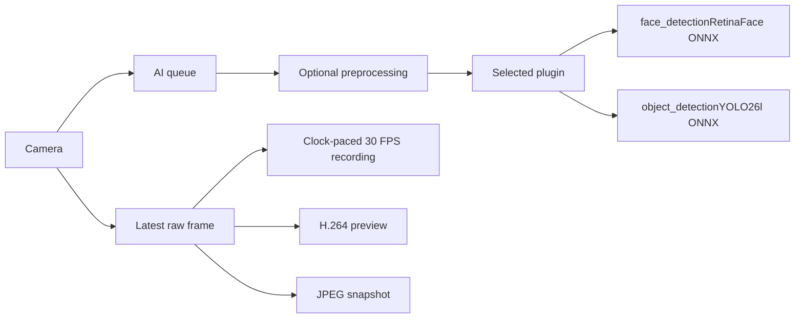

# Vision AI Box — လက်ရှိအခြေအနေ သုံးသပ်ချက် v0.1.1

ရက်စွဲ — ၂၀၂၆ နိုဝင်ဘာ ၂၃ (update)။ မူရင်း ၂၀၂၆ နိုဝင်ဘာ ၂၁ မှတ်တမ်းကို အခြေခံ၍ လက်ရှိ repo အခြေအနေနှင့် ဒီနေ့ စမ်းသပ်ချက်တွေ ထပ်ဖြည့်ထားသည်။

## အနှစ်ချုပ်

Camera, recording, web dashboard နှင့် plugin pipeline အခြေခံတွေ ရှိပြီးဖြစ်တယ်။ ဒီနေ့မှာ **face_detection plugin (RetinaFace ONNX)** ကို အသစ်ထည့်ပြီး C++ smoke test အောင်မြင်ပြီးဖြစ်တယ်။ **object_detection (YOLO26 Large ONNX)** အတွက်လည်း ONNX weights ကို ပြောင်းပြီး C++ smoke test အောင်မြင်ပြီးဖြစ်တယ်။ ONNX weights တွေကို plugin ရဲ့ ကိုယ်ပိုင် `models/` ထဲထားပြီး `.gitignore` နဲ့ exclude လုပ်ထားတယ်။ စမ်းသပ်မှုအားလုံးက compiled C++/CLI ဖြစ်ပြီး Python မပါဝင်ပါဘူး။ `.pt` နဲ့ Python conversion tool တွေကို repo အပြင်မှာထားပြီး repo ထဲ မထည့်ပါဘူး။

| အပိုင်း | လက်ရှိအခြေအနေ |
|---|---|
| Camera | USB/RealSense build-time ရွေးချယ်မှု၊ 30 FPS fixed၊ reconnect monitor ပါသည်။ |
| Dashboard | Login မလို၊ client အသစ်ဝင်လျှင် အဟောင်း session/stream ပိတ်သည်။ |
| Streaming | H.264/fragmented MP4 ကို browser MediaSource ဖြင့်ဖွင့်သည်။ Encoder တစ်ခုသာ run သည်။ |
| Recording | Steady-clock အလိုက် 30 FPS ရေးပြီး frame လွတ်ချိန် နောက်ဆုံးပုံထပ်သုံးသည်။ JPEG capture ပါသည်။ |
| AI pipeline | Optional downscale/filter၊ bounded queue၊ best-effort/reliable delivery နှင့် runtime API ပါသည်။ |
| face_detection | **အသစ်** — RetinaFace ResNet50 ONNX, ONNX Runtime CPU, normalized face box + confidence; smoke test အောင်မြင်ပြီး။ |
| object_detection | YOLO26 Large ONNX, static `[1,3,640,640]` → `[1,300,6]` end2end; smoke test အောင်မြင်ပြီး။ |
| tracking | Folder ရှိသော်လည်း source မရှိသေးပါ (နောက်ဆက်တွဲ အလုပ်)။ |
| Lifecycle | Camera controls serialization၊ worker join၊ weak callback၊ signal-safe shutdown flag နှင့် synchronous snapshot write ပါသည်။ |

## ဒီနေ့ လုပ်ဆောင်ချက်များနှင့် ရလဒ်များ (တကယ့် command output)

### Face detection

- `plugins/face_detection/` ထဲမှာ `RetinaFacePlugin.cpp`, `smoke.cpp`, `CMakeLists.txt`, `README.md`, `.gitignore`, `models/retinaface.onnx` ထည့်သွင်းပြီး `plugins/CMakeLists.txt` မှာ `VISION_BUILD_FACE_DETECTION` option ထပ်ထည့်ထားသည် (default OFF)။
- Model: `models/retinaface.onnx` (53 MB) ကို `leandroveronezi/go-onnxface` ရဲ့ `models-v1` release ကနေ ရယူထားသည်။ ဒါက `biubug6/Pytorch_Retinaface` ResNet50 `.pth` ကို upstream `convert_to_onnx.py` နဲ့ ပြောင်းထားတဲ့ ONNX export (FP16 weights, FP32 I/O) ဖြစ်သည်။ Input `input0` FP32 `[1,3,640,640]`, outputs `loc [1,N,4]`, `conf [1,N,2]`, `landms [1,N,10]` (`N=16800`)။
- Preprocess/decode: 640x640 top-left letterbox, BGR raw minus `(104,117,123)`, `/255` မလုပ်, channel swap မလုပ်; variances `(0.1,0.2)`, score = `conf[1]`, greedy NMS IoU `0.4`, box တွေကို letterbox scale နဲ့ ပြန်တွက်ပြီး normalized `[0,1]` အဖြစ် ထုတ်သည်။
- Build: host မှာ sudo မရှိ၍ OpenCV dev headers နှင့် nlohmann_json dev ကို Ubuntu `.deb` တွေကနေ `~/.hermes/cache/scratch/sysroot` ထဲ ထုတ်ယူသုံးသည်။ ONNX Runtime C++ SDK 1.23.2 ကို pip wheel ထဲက library + v1.23.2 header တွေနဲ့ ဖွဲ့စည်းသည်။ ဒီအားလုံး repo အပြင်မှာသာ ရှိပြီး repo ထဲ မထည့်ပါ။
- `cmake` configure အောင်မြင် (OpenCV 4.5.4, nlohmann_json 3.10.5, FFmpeg dev) ပြီး `face_detection_smoke` target ကို build လုပ်အောင်မြင်သည်။
- `face_detection_smoke retinaface.onnx amy.jpg` ကို C++ binary နဲ့ run လုပ်ရာ **မျက်နှာ ၁ ခု၊ confidence 0.99978၊ 0.54 s** ထွက်လာပြီး normalized box တွေ မှန်ကန်ကြောင်း၊ disabled လုပ်ရင် detection ပြန်မထွက်ကြောင်း စစ်ဆေးအောင်မြင်သည်။ Python တစ်ကြောင်းမှ မသုံးပါ။

### Object detection

- `yolo26l.pt` (51 MB) ကို Ultralytics assets release ကနေ repo အပြင် scratch ထဲ ရယူပြီး CPU-only torch/ultralytics toolchain နဲ့ ONNX ပြောင်းသည်။ Export arguments: `format=onnx imgsz=640 batch=1 dynamic=False half=False device=cpu end2end=True nms=False opset=17 simplify=False`။
- ရလဒ်: `plugins/object_detection/models/yolo26l.onnx` (95 MB) + `yolo26l.names.json` (80 labels)။ `onnx.checker` အောင်မြင်ပြီး input `[1,3,640,640]` FP32, output `[1,300,6]` FP32 ဖြစ်ကြောင်း အတည်ပြုသည်။ `.pt` ကို repo ထဲ မထည့်ပါ။
- `yolo26_smoke` target ကို build လုပ်ပြီး `bus.jpg` ပေါ်မှာ စမ်းရာ **person ၄ ခု + bus ၁ ခု** (အမြင့်ဆုံး confidence 0.9616) **0.68 s** နဲ့ ထွက်လာသည်။ Normalized box တွေနှင့် disabled behavior စစ်ဆေးချက် အောင်မြင်သည်။ Python မသုံးပါ။

## ကျန်ရှိချက်များနှင့် ကန့်သတ်ချက်

- Full application (`vision_ai_box`) ကို မဆောက်ရသေးပါ — host မှာ `libopencv_videoio` runtime မရှိသဖြင့် main executable link မလုပ်နိုင်သေးပါ။ Plugin smoke test အတွက်တော့ လုံလောက်ပါသည်။
- Tracking plugin က နောက်ဆက်တွဲ အဆင့်အဖြစ် ကျန်နေသေးသည်။
- Recording timeline C++ test, JavaScript syntax, mocked client takeover/reconnect tests တွေက မူရင်းမှတ်တမ်းအတိုင်း အောင်မြင်ဆဲဖြစ်သော်လည်း ဒီနေ့ ပြန်မrun ရသေးပါ။ HTTP integration, physical camera, video duration တို့ကိုလည်း မအတည်ပြုရသေးပါ။
- Reliable queue က capture ကို နှေးစေနိုင်သည်။ Native plugin hang/driver block ကို process isolation/watchdog ဖြင့် ထပ်ကာကွယ်ရန်လိုသည်။
- Dependency packaging, RealSense library path/version နှင့် source-relative web assets တွေကို deployment အတွက် ပြန်ညှိရန်လိုသည်။

## ယူဆချက် (Assumptions) / ယူဆစမ်းချက် (Hypotheses) — အတည်ပြုပြီး/မပြီး

- RetinaFace output အမည်နှင့် prior count 16800 ဆိုတာ release documentation အခြေခံ ယူဆချက်ဖြစ်ပြီး တကယ့် ONNX session နဲ့ လိုက်ဖက်ကြောင်း စမ်းသပ်မှုက အတည်ပြုပြီးဖြစ်သည်။
- RetinaFace zero-padding က detect.py letterbox နဲ့ အနည်းငယ်ကွဲနိုင်ပေမယ့် မျက်နှာ တစ်ခုအပေါ် ရလဒ် အပြောင်းအလဲ မရှိသလောက်ဖြစ်တယ်ဆိုတာ upstream regression test အခြေခံ ယူဆချက်ဖြစ်နေဆဲဖြစ်သည်။
- YOLO26 `end2end=True, nms=False` export က `[1,N,6]` output ထွက်မယ်ဆိုတာ ယူဆချက်မဟုတ်တော့ဘူး — တကယ့် export မှာ `[1,300,6]` ထွက်ကြောင်း အတည်ပြုပြီးဖြစ်သည်။

ဦးစားပေးဆက်လုပ်ရန် — tracking plugin ထည့်သွင်းမှု၊ full build/CTest၊ camera unplug/replug၊ client နှစ်ခု takeover နှင့် `ffprobe` ဖြင့် recording ကြာချိန်တိုင်းတာမှု။
