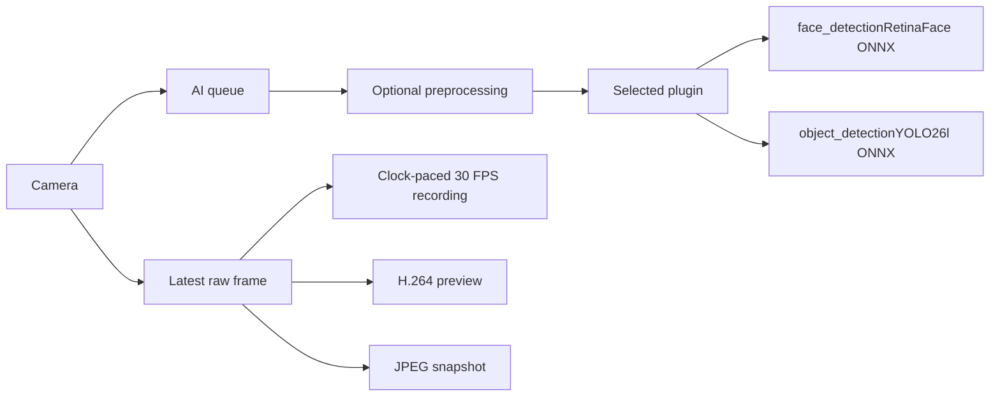

# Vision AI Box — လက်ရှိအခြေအနေ သုံးသပ်ချက် v0.1.1

ရက်စွဲ — ၂၀၂၆ နိုဝင်ဘာ ၂၆ (update)။ မူရင်း ၂၀၂၆ နိုဝင်ဘာ ၂၁ မှတ်တမ်းနှင့် ၂၃ ရက် ONNX smoke test မှတ်တမ်းတို့ကို အခြေခံ၍ preview frame lag ရောဂါရှာဖွေချက်၊ ပြုပြင်ချက်နှင့် ဒီနေ့ စမ်းသပ်ချက်တွေကို ထပ်ဖြည့်ထားသည်။

## အနှစ်ချုပ်

Camera, recording, web dashboard နှင့် plugin pipeline အခြေခံတွေ ရှိပြီးဖြစ်တယ်။ ဒီနေ့မှာ **face_detection plugin (RetinaFace ONNX)** ကို အသစ်ထည့်ပြီး C++ smoke test အောင်မြင်ပြီးဖြစ်တယ်။ **object_detection (YOLO26 Large ONNX)** အတွက်လည်း ONNX weights ကို ပြောင်းပြီး C++ smoke test အောင်မြင်ပြီးဖြစ်တယ်။ ONNX weights တွေကို plugin ရဲ့ ကိုယ်ပိုင် `models/` ထဲထားပြီး `.gitignore` နဲ့ exclude လုပ်ထားတယ်။ စမ်းသပ်မှုအားလုံးက compiled C++/CLI ဖြစ်ပြီး Python မပါဝင်ပါဘူး။ `.pt` နဲ့ Python conversion tool တွေကို repo အပြင်မှာထားပြီး repo ထဲ မထည့်ပါဘူး။

| အပိုင်း | လက်ရှိအခြေအနေ |
|---|---|
| Camera | USB/RealSense build-time ရွေးချယ်မှု၊ 30 FPS fixed၊ reconnect monitor ပါသည်။ |
| Dashboard | Login မလို၊ client အသစ်ဝင်လျှင် အဟောင်း session/stream ပိတ်သည်။ |
| Streaming | H.264/fragmented MP4 ကို browser MediaSource ဖြင့်ဖွင့်သည်။ Encoder တစ်ခုသာ run သည်။ Preview PTS ကို steady clock မှ ယူပြီး dashboard က live edge သို့ ပြန်ညှိသည် (၂၀၂၆-၁၁-၂၆ ပြုပြင်ချက်)။ |
| Recording | Steady-clock အလိုက် 30 FPS ရေးပြီး frame လွတ်ချိန် နောက်ဆုံးပုံထပ်သုံးသည်။ JPEG capture ပါသည်။ |
| AI pipeline | Optional downscale/filter၊ bounded queue၊ best-effort/reliable delivery နှင့် runtime API ပါသည်။ |
| face_detection | **အသစ်** — RetinaFace ResNet50 ONNX, ONNX Runtime CPU, normalized face box + confidence; smoke test အောင်မြင်ပြီး။ |
| object_detection | YOLO26 Large ONNX, static `[1,3,640,640]` → `[1,300,6]` end2end; smoke test အောင်မြင်ပြီး။ |
| tracking | Folder ရှိသော်လည်း source မရှိသေးပါ (နောက်ဆက်တွဲ အလုပ်)။ |
| Lifecycle | Camera controls serialization၊ worker join၊ weak callback၊ signal-safe shutdown flag နှင့် synchronous snapshot write ပါသည်။ |

## ဒီနေ့ လုပ်ဆောင်ချက်များနှင့် ရလဒ်များ (တကယ့် command output)

### Face detection

- `plugins/face_detection/` ထဲမှာ `RetinaFacePlugin.cpp`, `smoke.cpp`, `CMakeLists.txt`, `README.md`, `.gitignore`, `models/retinaface.onnx` ထည့်သွင်းပြီး `plugins/CMakeLists.txt` မှာ `VISION_BUILD_FACE_DETECTION` option ထပ်ထည့်ထားသည် (default OFF)။
- Model: `models/retinaface.onnx` (53 MB) ကို `leandroveronezi/go-onnxface` ရဲ့ `models-v1` release ကနေ ရယူထားသည်။ ဒါက `biubug6/Pytorch_Retinaface` ResNet50 `.pth` ကို upstream `convert_to_onnx.py` နဲ့ ပြောင်းထားတဲ့ ONNX export (FP16 weights, FP32 I/O) ဖြစ်သည်။ Input `input0` FP32 `[1,3,640,640]`, outputs `loc [1,N,4]`, `conf [1,N,2]`, `landms [1,N,10]` (`N=16800`)။
- Preprocess/decode: 640x640 top-left letterbox, BGR raw minus `(104,117,123)`, `/255` မလုပ်, channel swap မလုပ်; variances `(0.1,0.2)`, score = `conf[1]`, greedy NMS IoU `0.4`, box တွေကို letterbox scale နဲ့ ပြန်တွက်ပြီး normalized `[0,1]` အဖြစ် ထုတ်သည်။
- Build: host မှာ sudo မရှိ၍ OpenCV dev headers နှင့် nlohmann_json dev ကို Ubuntu `.deb` တွေကနေ `~/.hermes/cache/scratch/sysroot` ထဲ ထုတ်ယူသုံးသည်။ ONNX Runtime C++ SDK 1.23.2 ကို pip wheel ထဲက library + v1.23.2 header တွေနဲ့ ဖွဲ့စည်းသည်။ ဒီအားလုံး repo အပြင်မှာသာ ရှိပြီး repo ထဲ မထည့်ပါ။
- `cmake` configure အောင်မြင် (OpenCV 4.5.4, nlohmann_json 3.10.5, FFmpeg dev) ပြီး `face_detection_smoke` target ကို build လုပ်အောင်မြင်သည်။
- `face_detection_smoke retinaface.onnx amy.jpg` ကို C++ binary နဲ့ run လုပ်ရာ **မျက်နှာ ၁ ခု၊ confidence 0.99978၊ 0.54 s** ထွက်လာပြီး normalized box တွေ မှန်ကန်ကြောင်း၊ disabled လုပ်ရင် detection ပြန်မထွက်ကြောင်း စစ်ဆေးအောင်မြင်သည်။ Python တစ်ကြောင်းမှ မသုံးပါ။

### Object detection

- `yolo26l.pt` (51 MB) ကို Ultralytics assets release ကနေ repo အပြင် scratch ထဲ ရယူပြီး CPU-only torch/ultralytics toolchain နဲ့ ONNX ပြောင်းသည်။ Export arguments: `format=onnx imgsz=640 batch=1 dynamic=False half=False device=cpu end2end=True nms=False opset=17 simplify=False`။
- ရလဒ်: `plugins/object_detection/models/yolo26l.onnx` (95 MB) + `yolo26l.names.json` (80 labels)။ `onnx.checker` အောင်မြင်ပြီး input `[1,3,640,640]` FP32, output `[1,300,6]` FP32 ဖြစ်ကြောင်း အတည်ပြုသည်။ `.pt` ကို repo ထဲ မထည့်ပါ။
- `yolo26_smoke` target ကို build လုပ်ပြီး `bus.jpg` ပေါ်မှာ စမ်းရာ **person ၄ ခု + bus ၁ ခု** (အမြင့်ဆုံး confidence 0.9616) **0.68 s** နဲ့ ထွက်လာသည်။ Normalized box တွေနှင့် disabled behavior စစ်ဆေးချက် အောင်မြင်သည်။ Python မသုံးပါ။

### Preview frame lag — ရောဂါရှာဖွေခြင်းနှင့် ပြုပြင်ခြင်း (၂၀၂၆ နိုဝင်ဘာ ၂၆)

- **ပြဿနာ**: live preview က တဖြည်းဖြည်း နောက်ကျနေပြီး ဒီအခြေအနေမှာ AI/အခြား plugin ထည့်သည့် အဆင့်ကို ဆက်လုပ်လို့ မရဖြစ်နေတယ်။
- **အကြောင်းရင်း (အတည်ပြုပြီး)**:
  - H.264 PTS ကို `pts_++` ဖြင့် encode လုပ်သည့် ဖရိမ်အရေအတွက်အတိုင်း ထုတ်နေခဲ့တယ် (`H264Stream.cpp:297` အဟောင်း)။ Muxer time_base က `1/fps` ဖြစ်တော့ encode လုပ်မှသာ media time တက်တယ်။
  - `WebServer.cpp:623-625` က deadline ကို `max(deadline, delivered) + interval` လို့ ရွှေ့ခဲ့တော့ encode/send/camera stall ကြောင့် ကျော်သွားတဲ့ အချိန်ကို နောက်တွဲ ပြန်မမီဘဲ ထာဝရ နောက်ဆုတ်သွားတယ်။
  - Skip လုပ်လိုက်တဲ့ ဖရိမ်တွေအတွက် timestamp gap မထည့်တာကြောင့် ဆုံးရှုံးချိန်ကို video ထဲမှာ မမြင်ရဘဲ အပေါ်ယံ အဆင်ပြေနေသလို ဖြစ်နေတယ်။
  - Browser MSE (`app.js`) မှာ `buffered`/`currentTime` နဲ့ live edge ကို ပြန်ညှိတဲ့ ကုဒ် မရှိတော့ တစ်ခေါက်နောက်ကျရင် ပြန်မီတဲ့ ယန္တရား မရှိဘူး။
  - ၂၀၂၆-၁၁-၂၄ log မှာ `frames=796, skipped=901, quality=85, step=0` ဖြစ်နေတာက congestion controller မအောင်မြင်ခဲ့တာကို ပြတယ် — ဒါကြောင့် network send-time က အဓိက အကြောင်းရင်း မဟုတ်ပါဘူး။
- **လုပ်ဆောင်ချက် (C++ ထဲမှာပဲ ပြင်၊ Python/web_server ပြန်ရေးခြင်း မလုပ်)**:
  - `core/include/StreamClock.hpp` အသစ်ထည့်ပြီး `StreamClock::pts_for()` က steady clock မှ PTS တွက်ပေး၊ `schedule_next_frame()` က slot အလိုက် ရှေ့ဆက်ပေးပြီး overshoot ကို မစုပေါင်းစေတော့ဘူး။
  - `H264Stream` မှာ frame-count PTS ဖယ်ရှားပြီး `open()` မှာ clock reset, packet duration ကို 1 tick သတ်မှတ်, `last_pts()` telemetry ထည့်သွင်း။
  - `WebServer.cpp:623` မှာ deadline debt မစုအောင် `schedule_next_frame()` သုံးပြီး နောက်ကျရင် slot ကို ကျော်လိုက်ရုံသာ ဖြစ်စေတယ်။
  - `app.js` မှာ `keepLiveEdge()` (500 ms poll + `updateend`) ထည့်ပြီး 1 s ထက် နောက်ကျရင် `buffered.end() - 0.35 s` သို့ seek, 5 s ထက် ဟောင်းတဲ့ buffer ကို remove။ Stream ရပ်ရင် timer ရှင်းတယ်။
  - `core/tests/StreamClockTests.cpp` နဲ့ CTest target ထည့်ပြီး README မှာ မှတ်တမ်းတင်ထားတယ်။
- **တကယ့် command output / ရလဒ်**:
  - `cmake -S . -B build-usb -DCMAKE_BUILD_TYPE=Release -DCAMERA=USB -DBUILD_TESTING=ON && cmake --build build-usb -j && ctest --test-dir build-usb --output-on-failure` → **3/3 pass** (`recording_clock_tests`, `pipeline_tests`, `stream_clock_tests`)။
  - Real `H264Stream` harness မှာ 120 ms camera stall ထည့်ထားချိန် 6 s အတွင်း lag **0.401 s → 0.000 s**၊ မြန်တဲ့ sink မှာ **0.117 s → 0.067 s**၊ delivery 15.00 fps ရှိတယ်။
  - တကယ့် USB camera (`/dev/video0`) ပေါ် 8 s stream → `moof`/`mdat` ၁၂၀ စီ၊ `ffprobe` duration **8.000000 s** (ပြုပြင်ခင် ၁၁၈ ခု / 7.87 s)။ Camera 29.83 fps, quality 80, step 0 ဖြစ်ပြီး congestion မတက်ဘူး။
  - `node --check core/web_server/app.js`, `node tests/client_ui_test.cjs`, `python3 tests/client_takeover_test.py --url http://127.0.0.1:18080` အားလုံး **pass**။
- **ယူဆချက်**: "frame lag" ဆိုတာ live preview ရဲ့ နောက်ကျမှုသာ ဖြစ်ပြီး AI queue ထဲ ရောက်တဲ့ ဖရိမ်တွေ မဟုတ်ပါဘူး။ Detection box တွေ နောက်ကျတာက သီးခြား ကိစ္စဖြစ်ပြီး `app.js:361-364` မှာ မူရင်းအတိုင်း မှတ်ထားပြီးသား။
- **ဆုံးဖြတ်ချက်**: `cv2.VideoCapture`/Python က ပိုမြန်တယ်ဆိုတဲ့ အယူအဆကို မလိုက်ဘဲ C++ pipeline ထဲမှာပဲ အချိန်ကို ပြင်။ Default AI queue က `best_effort`/capacity 1 (`PluginManager.hpp:71`) ဖြစ်နေသရွေ့ နှေးတဲ့ detector က capture ကို မပိတ်ပါဘူး။
- **ကျန်ရှိချက် / နောက်တစ်ဆင့်**: target device ရဲ့ browser မှာ မြင်ကွင်းအတိုင်း အတည်ပြုရန်၊ လိုအပ်ရင် `stream_fps`/latency ကို `/api/camera/status` ထဲ ထည့်ပေးရန်။ **ဒီ preview lag အဆင့် ပြီးဆုံးပြီဖြစ်တော့ tracking/AI plugin ထည့်သည့် အဆင့်ကို ဆက်လုပ်နိုင်ပါပြီ။**

## ကျန်ရှိချက်များနှင့် ကန့်သတ်ချက်

- Full application (`vision_ai_box`) ကို ၂၀၂၆-၁၁-၂၆ မှာ system OpenCV 4.5.4, nlohmann_json 3.10.5, FFmpeg 4.x တို့နဲ့ အောင်မြင်စွာ build လုပ်ပြီး USB camera (`/dev/video0`) ပေါ်မှာ run ပြီးပါပြီ။ အထက်ပါ ၂၃ ရက်က မှတ်ချက်က ထိုအချိန်က အခြေအနေသာ ဖြစ်ပါသည်။
- Tracking plugin က နောက်ဆက်တွဲ အဆင့်အဖြစ် ကျန်နေသေးသည်။
- Recording timeline C++ test, JavaScript syntax, mocked client takeover/reconnect test တွေကို ဒီနေ့ ပြန်လည် run ခဲ့ပြီး အားလုံး pass ပါတယ် (`ctest` 3/3, `node --check`, `client_ui_test.cjs`, `client_takeover_test.py`)။ တကယ့် HTTP preview stream နဲ့ physical USB camera ကိုလည်း စမ်းပြီးပါပြီ။ ကျန်တာက target device မှာ `ffprobe` ဖြင့် recorded video duration တိုင်းတာချက်နှင့် RealSense hardware စမ်းသပ်ချက်တို့ဖြစ်ပါသည်။
- Reliable queue က capture ကို နှေးစေနိုင်သည်။ Native plugin hang/driver block ကို process isolation/watchdog ဖြင့် ထပ်ကာကွယ်ရန်လိုသည်။
- Dependency packaging, RealSense library path/version နှင့် source-relative web assets တွေကို deployment အတွက် ပြန်ညှိရန်လိုသည်။

## ယူဆချက် (Assumptions) / ယူဆစမ်းချက် (Hypotheses) — အတည်ပြုပြီး/မပြီး

- RetinaFace output အမည်နှင့် prior count 16800 ဆိုတာ release documentation အခြေခံ ယူဆချက်ဖြစ်ပြီး တကယ့် ONNX session နဲ့ လိုက်ဖက်ကြောင်း စမ်းသပ်မှုက အတည်ပြုပြီးဖြစ်သည်။
- RetinaFace zero-padding က detect.py letterbox နဲ့ အနည်းငယ်ကွဲနိုင်ပေမယ့် မျက်နှာ တစ်ခုအပေါ် ရလဒ် အပြောင်းအလဲ မရှိသလောက်ဖြစ်တယ်ဆိုတာ upstream regression test အခြေခံ ယူဆချက်ဖြစ်နေဆဲဖြစ်သည်။
- YOLO26 `end2end=True, nms=False` export က `[1,N,6]` output ထွက်မယ်ဆိုတာ ယူဆချက်မဟုတ်တော့ဘူး — တကယ့် export မှာ `[1,300,6]` ထွက်ကြောင်း အတည်ပြုပြီးဖြစ်သည်။

ဦးစားပေးဆက်လုပ်ရန် — preview lag ပြုပြင်ချက် အတည်ပြုပြီးဖြစ်တော့ **tracking plugin ထည့်သွင်းမှုကို ဆက်လုပ်ရန်**၊ ထို့နောက် target device မှာ camera unplug/replug၊ client နှစ်ခု takeover နှင့် `ffprobe` ဖြင့် recording ကြာချိန်တိုင်းတာမှု။
