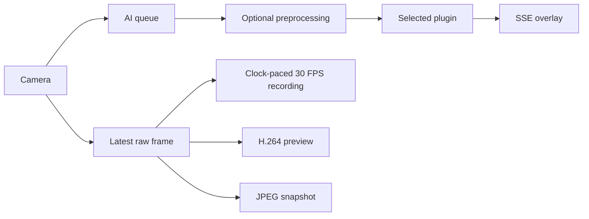

# Vision AI Box — လက်ရှိအခြေအနေ သုံးသပ်ချက် v0.1.1

ရက်စွဲ — ၂၀၂၆ နိုဝင်ဘာ ၂၁။ ပျောက်သွားသော analysis ကို `c1d0975` နှင့် ပြန်လည်ထည့်သွင်းထားသော changes အပေါ် အခြေခံ၍ ပြန်ရေးထားသည်။

## အနှစ်ချုပ်

Camera၊ recording၊ web dashboard နှင့် plugin pipeline အခြေခံများ ရေးထားပြီးဖြစ်သည်။ YOLO26 Large CPU inference plugin ထည့်ထားသော်လည်း real model/hardware ဖြင့် အတည်မပြုရသေးသဖြင့် production အသင့်ဖြစ်သည်ဟု မသတ်မှတ်နိုင်သေးပါ။

| အပိုင်း | လက်ရှိအခြေအနေ |
|---|---|
| Camera | USB/RealSense build-time ရွေးချယ်မှု၊ 30 FPS fixed၊ reconnect monitor ပါသည်။ |
| Dashboard | Login မလို၊ client အသစ်ဝင်လျှင် အဟောင်း session/stream ပိတ်သည်။ |
| Streaming | H.264/fragmented MP4 ကို browser MediaSource ဖြင့်ဖွင့်သည်။ Encoder တစ်ခုသာ run သည်။ |
| Recording | Steady-clock အလိုက် 30 FPS ရေးပြီး frame လွတ်ချိန် နောက်ဆုံးပုံထပ်သုံးသည်။ JPEG capture ပါသည်။ |
| AI pipeline | Optional downscale/filter၊ bounded queue၊ best-effort/reliable delivery နှင့် runtime API ပါသည်။ |
| Plugins | Example သည် demo၊ face recognition သည် prototype၊ YOLO26 သည် optional ONNX Runtime CPU inference ဖြစ်သည်။ |
| Lifecycle | Camera controls serialization၊ worker join၊ weak callback၊ signal-safe shutdown flag နှင့် synchronous snapshot write ပါသည်။ |

## စစ်ဆေးမှုနှင့် ကျန်ရှိချက်များ

- Recording timeline C++ test၊ JavaScript syntax နှင့် mocked client takeover/reconnect tests အောင်မြင်သည်။ Python helper syntax/arguments စစ်ဆေးနိုင်သည်။
- Full CMake configuration သည် OpenCV development package မရှိ၍ ရပ်သည်။ HTTP integration၊ physical camera၊ YOLO model inference နှင့် video duration ကို မအတည်ပြုရသေးပါ။
- Writer အောင်မြင်စွာရေးနိုင်လျှင် timeline duration က frame တစ်ခုအောက်သာ ကွာရန် ရည်ရွယ်ထားသည်။ Camera stalls တွင် video freeze ဖြစ်မည်။ Disk/codec မလိုက်နိုင်လျှင် finalization နှောင့်နှေးနိုင်သည်။
- Reliable queue သည် capture ကိုနှေးစေနိုင်သည်။ Native plugin hang/driver block ကို process isolation/watchdog ဖြင့် ထပ်ကာကွယ်ရန်လိုသည်။
- Dependency packaging၊ RealSense library path/version နှင့် source-relative web assets များကို deployment အတွက် ပြန်ညှိရန်လိုသည်။

ဦးစားပေးဆက်လုပ်ရန် — full build/CTest၊ model smoke test၊ camera unplug/replug၊ client နှစ်ခု takeover၊ port-in-use/SIGTERM စမ်းသပ်မှုနှင့် `ffprobe` ဖြင့် recording ကြာချိန်တိုင်းတာမှု။
