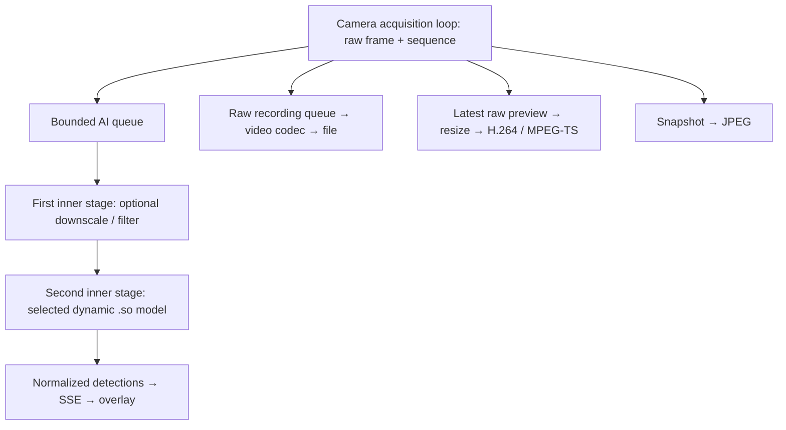

# Vision AI Box - Deep Blue AI Lab

docker run --rm -it \
  --privileged \
  --network host \
  -v /home/ghost/Desktop/core3:/home/ghost/core3 \
  -v /dev:/dev \
  doxchanger/private:vision_ai_box_builder \
  bash

Inside the container, switch to the project user before building:

```sh
su - ghost
cd /home/ghost/core3
```

```
# The same command with explicit HTTP port publishing instead of host networking:
# docker run --rm -it \
#   --privileged \
#   -p 8080:8080 \
#   -v /home/ghost/Desktop/core3:/home/ghost/core3 \
#   -v /dev:/dev \
#   doxchanger/private:vision_ai_box_builder \
#   bash
```

Build and run USB mode:

```sh
cmake -S . -B build-usb -DCMAKE_BUILD_TYPE=Release -DCAMERA=USB
cmake --build build-usb -j"$(nproc)"
./build-usb/bin/vision_ai_box
```


Build and run RealSense mode:

```sh
cmake -S . -B build-realsense -DCMAKE_BUILD_TYPE=Release \
  -DCAMERA=REALSENSE -DLIBREALSENSE_DIR=/home/ghost/librealsense
cmake --build build-realsense -j"$(nproc)"
./build-realsense/bin/vision_ai_box
```

```
export VISION_AI_BOX_USERNAME=admin
export VISION_AI_BOX_PASSWORD='admin'
export VISION_AI_BOX_PORT=8080
```

The embedded web server listens on port `8080` by default. Set
`VISION_AI_BOX_PORT` to select another port. Credentials default to
`admin` / `change-me`; configure them with `VISION_AI_BOX_USERNAME` and
`VISION_AI_BOX_PASSWORD` before starting the application.

Open `http://<device-ip>:8080/` from a device on the same network. The login
creates an HttpOnly session cookie and redirects to `/dashboard`. Protected
endpoints include `/api/camera/status`, `/api/camera/start`,
`/api/camera/stop`, `/api/camera/stream`, and `/api/plugins`.

Plugin libraries are discovered at application startup but are not loaded. The
Plugin page lists available libraries with no active selection. Selecting a
plugin calls `POST /api/plugins`, which loads that library at runtime and makes
it the active plugin. Only the selected plugin receives frames.

## Frame workflow

The outer loop is the camera acquisition loop, accepting decoded camera frames
(`cv::Mat` color and optional aligned 16-bit depth). Here "raw" means unmodified
camera pixels in memory, not Bayer sensor RAW. The main service loop only manages
lifetime. Nested stages are logical stages, not blocking infinite loops inside
capture: capture and AI each have their own worker.



The two inner stages run sequentially in the AI worker. This keeps preprocessing
and model execution ordered with one pending-frame queue. A separate preprocessing
worker and second queue can be added if profiling shows a throughput benefit.
Recording and preview subscribe directly to raw capture; changing AI quality does
not change their resolution or the physical camera settings.

### First inner stage: preprocessing and QoS

`FramePreprocessor.hpp` implements optional preprocessing. It is **off by default**.
Even in bypass mode, the model receives owned copies so a plugin cannot overwrite
the raw buffers shared with recording/preview. With preprocessing enabled:

| Setting | Behavior |
| --- | --- |
| `mode: downscale` | Aspect-preserving reduction, never upscale |
| `mode: filter` | Same reduction, followed by a 3×3 Gaussian color filter |
| `quality: low` | Longest color edge at most 640 pixels |
| `quality: medium` | Longest color edge at most 1280 pixels |
| `quality: high` | Native dimensions |

Aligned depth follows the same dimensions using nearest-neighbor sampling,
preserving integer depth units. Filtering does not blur depth. Normalized boxes
remain usable on the original preview because the resize preserves the full view.
Model-specific letterboxing, channel conversion, tensor normalization and output
coordinate conversion still belong inside each model plugin.

Quality and delivery are separate settings:

| Delivery policy | Full queue behavior | Trade-off |
| --- | --- | --- |
| `best_effort` (default) | Evict oldest pending frame | Fresh detections, bounded memory |
| `reliable` | Block producer until space becomes available | FIFO delivery, capture/preview/recording may slow down |

`queue_capacity` accepts 1–32 frames. These are application queue policies, not
DDS/ROS or network delivery guarantees. Reliable means no overflow eviction in
this queue during steady operation; it does not guarantee sensor, driver, network
or disk delivery. Changing configuration, unloading a model and shutting down
explicitly discard queued frames. One frame already in progress can finish using
the previous settings. Queue capacity alone does not bound inference time.

For live camera use, start with `best_effort`, capacity 1, downscale/medium and
measure detection accuracy before enabling blur or reducing resolution. For
lossless acquisition with a slower detector, use a separate durable recording/spool
and offline inference; finite RAM cannot preserve an unlimited producer backlog.

Compression is deliberately on the **output branches**. The current preview uses
H.264 in MPEG-TS, recording uses `VideoWriter`, and snapshots use JPEG. The local
model consumes decoded pixels. `compressed` is not an AI preprocessing mode:
compressing then immediately decoding adds work and can lose image detail. For a
future remote detector, add an encoder → transport → decoder branch with its own
QoS and measurements. Merely lowering JPEG quality is not a reliability policy.

### Runtime configuration

The existing login/session authentication also protects the new endpoints:

- `GET /api/pipeline`: settings, queue drops/rejections and processing errors.
- `POST /api/pipeline`: validated partial settings update, without restarting the camera.

Example request body for `POST /api/pipeline`:

```json
{
  "enabled": true,
  "mode": "downscale",
  "quality": "medium",
  "delivery": "best_effort",
  "queue_capacity": 1
}
```

Send `{"enabled": false}` to bypass transformations while keeping model inference
active. Set `delivery` to `reliable` independently of the preprocessing toggle.
Unknown keys, invalid modes/policies and invalid capacities return HTTP 400.
Configuration is in memory and resets on restart. These controls are API-only;
the dashboard does not yet expose a pipeline settings form. The drop counter
counts overflow evictions and rejected pushes, not frames cleared at boundaries.

### Second inner stage: dynamically linked models

`PluginManager` discovers `.so` files and uses the existing `create_plugin` /
`destroy_plugin` factories. `POST /api/plugins` selects one model at runtime;
`POST /api/plugins/unload` removes a model. Only the selected model receives
prepared frames. Shared ownership keeps its library alive during in-flight work.
Results from a removed instance are rejected before publication. Plugin settings,
enable/disable and inference calls are serialized per instance. Calls reading a
plugin's settings can therefore wait for its current inference to finish.

Initialization failures release the plugin/library; preprocessing and inference
exceptions are counted/logged instead of escaping the worker thread. Native
crashes and permanently hung plugins still need process isolation or a watchdog.
All plugins must be built with a compatible C++/OpenCV ABI.

**The existing models are prototypes:** `example` emits a synthetic moving box;
`face_recognition` returns no detections. Object detection and the depth plugin
directories are not enabled in `plugins/CMakeLists.txt`. This pipeline does not
supply trained model weights or a real inference backend.

### Capture lifetime and outputs

Camera sequence numbers continue across restarts, so the preview's "newer frame"
comparison and recording duplicate detection do not stall waiting for a reset
sequence to catch up. A finished USB worker is joined before replacement. During
application shutdown, the AI queue closes first to release blocked reliable-mode
producers, then capture and server shutdown proceed.

Recording has its own eight-frame drop-oldest queue. Its writer currently uses
30 FPS regardless of camera FPS; dropped frames or a different capture rate can
therefore distort playback duration. Preview has a per-client latest-frame
mailbox and adaptive H.264 output. RealSense depth is currently supplied to the AI
callback but not streamed or recorded by those output paths.

### Follow-up priorities

1. Implement a real detector plugin with model input/output metadata and measured
   latency; validate normalized boxes after its own resize/letterbox transform.
2. Centralize camera start/stop/settings/reconnect ownership. The monitor and HTTP
   control paths still share camera settings/state and need a coordinated command
   path before more runtime camera features are added.
3. Use capture timestamps and actual FPS for recording; track end-to-end frame age,
   stage latency and queue depth, then set explicit latency budgets.
4. Add pipeline controls and persistence if operators need to manage these settings
   from the dashboard; keep transport compression and AI quality separate.
5. Validate USB reconnect, RealSense alignment, rapid model switching and overload
   with physical hardware and actual models before deployment.

## Validation

With the build dependencies installed:

```sh
cmake -S . -B build-usb -DCMAKE_BUILD_TYPE=Debug -DCAMERA=USB -DBUILD_TESTING=ON
cmake --build build-usb -j
ctest --test-dir build-usb --output-on-failure
```

`pipeline_tests` covers best-effort eviction, reliable FIFO/backpressure, producer
release on close/reconfiguration, invalid settings, bypass buffer isolation,
aspect-preserving resizing and depth preservation. It does not require a camera.
Hardware behavior and model-switch concurrency still need integration testing.
