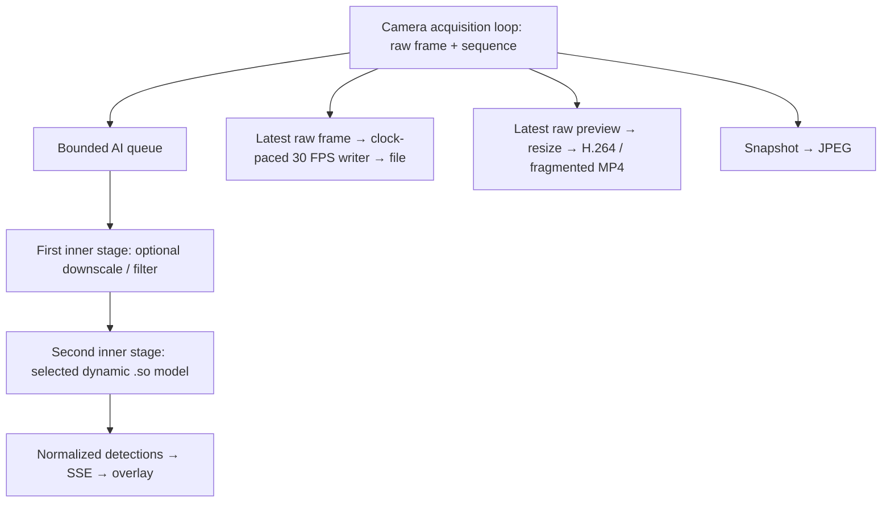

# Vision AI Box - Deep Blue AI Lab

docker run --rm -it \
  --privileged \
  --network host \
  -v /home/ghost/Desktop/core3:/home/ghost/core3 \
  -v /dev:/dev \
  doxchanger/private:vision_ai_box_builder \
  bash

Inside the container, switch to the project user before building:

```sh
su - ghost
cd /home/ghost/core3
```

```
# The same command with explicit HTTP port publishing instead of host networking:
# docker run --rm -it \
#   --privileged \
#   -p 8080:8080 \
#   -v /home/ghost/Desktop/core3:/home/ghost/core3 \
#   -v /dev:/dev \
#   doxchanger/private:vision_ai_box_builder \
#   bash
```

Build and run USB mode:

```sh
cmake -S . -B build-usb -DCMAKE_BUILD_TYPE=Release -DCAMERA=USB
cmake --build build-usb -j"$(nproc)"
./build-usb/bin/vision_ai_box
```

### One-command automation

`./automation` does configure → build → ctest → UI regression checks → starts the
binary on `http://<device-ip>:8080/` from the project root (Ctrl-C stops it).
Useful overrides:

```sh
PORT=18080 ./automation                 # different HTTP port
CAMERA=REALSENSE LIBREALSENSE_DIR=/path/to/librealsense ./automation
BUILD_TYPE=Debug VISION_OPTIMIZE_SIZE=OFF ./automation
VISION_BUILD_FACE_DETECTION=ON ONNXRUNTIME_ROOT=/path/to/ort ./automation
./automation --no-run                   # build and test only
./automation --help                     # all options
```

`BUILD_DIR`, `JOBS`, `BUILD_TYPE` and the `VISION_*` CMake options can also be
set as environment variables; they are forwarded to CMake unchanged.


Build and run RealSense mode:

```sh
cmake -S . -B build-realsense -DCMAKE_BUILD_TYPE=Release \
  -DCAMERA=REALSENSE -DLIBREALSENSE_DIR=/home/ghost/librealsense
cmake --build build-realsense -j"$(nproc)"
./build-realsense/bin/vision_ai_box
```

## Dashboard: one client, no login

Open `http://<device-ip>:8080/` or `/dashboard`. Set `VISION_AI_BOX_PORT` to
change the port. Username/password, login form, login API and authentication
cookies have been removed. Anyone who can reach the service can take control.

Each page load calls `POST /api/client` once and receives a page-local token.
Opening another browser, tab or reloading replaces the previous client. The
old page closes its SSE/video connections and displays Reconnect; its API
requests return HTTP `409`. Automatic SSE/video retries reuse the token and
never claim ownership again. Pressing Reconnect explicitly takes control back.
Already admitted control commands finish before takeover is accepted. Video
teardown is cooperative: a current encode/write may finish before closing.
There is one H.264 encoder at a time. Recording and AI continue across takeover.
Already downloaded media cannot be withdrawn from an old client.

API clients claim once with `POST /api/client`, then send the returned `client`
as `X-Vision-Client: <token>`. EventSource and media links use `?client=<token>`.
This token coordinates ownership; it is not username/password authentication.

Plugin libraries are discovered at application startup but are not loaded. The
Plugin page lists available libraries with no active selection. Selecting a
plugin calls `POST /api/plugins`, which loads that library at runtime and makes
it the active plugin. Only the selected plugin receives frames.

## Frame workflow

The outer loop is the camera acquisition loop, accepting decoded camera frames
(`cv::Mat` color and optional aligned 16-bit depth). Here "raw" means unmodified
camera pixels in memory, not Bayer sensor RAW. The main service loop only manages
lifetime. Nested stages are logical stages, not blocking infinite loops inside
capture: capture and AI each have their own worker.



The two inner stages run sequentially in the AI worker. This keeps preprocessing
and model execution ordered with one pending-frame queue. A separate preprocessing
worker and second queue can be added if profiling shows a throughput benefit.
Recording samples the latest raw frame and preview subscribes to raw capture; changing AI quality does
not change their resolution or the physical camera settings.

### First inner stage: preprocessing and QoS

`FramePreprocessor.hpp` implements optional preprocessing. It is **off by default**.
Even in bypass mode, the model receives owned copies so a plugin cannot overwrite
the raw buffers shared with recording/preview. With preprocessing enabled:

| Setting | Behavior |
| --- | --- |
| `mode: downscale` | Aspect-preserving reduction, never upscale |
| `mode: filter` | Same reduction, followed by a 3×3 Gaussian color filter |
| `quality: low` | Longest color edge at most 640 pixels |
| `quality: medium` | Longest color edge at most 1280 pixels |
| `quality: high` | Native dimensions |

Aligned depth follows the same dimensions using nearest-neighbor sampling,
preserving integer depth units. Filtering does not blur depth. Normalized boxes
remain usable on the original preview because the resize preserves the full view.
Model-specific letterboxing, channel conversion, tensor normalization and output
coordinate conversion still belong inside each model plugin.

Quality and delivery are separate settings:

| Delivery policy | Full queue behavior | Trade-off |
| --- | --- | --- |
| `best_effort` (default) | Evict oldest pending frame | Fresh detections, bounded memory |
| `reliable` | Block producer until space becomes available | FIFO delivery, capture/preview/recording may slow down |

`queue_capacity` accepts 1–32 frames. These are application queue policies, not
DDS/ROS or network delivery guarantees. Reliable means no overflow eviction in
this queue during steady operation; it does not guarantee sensor, driver, network
or disk delivery. Changing configuration, unloading a model and shutting down
explicitly discard queued frames. One frame already in progress can finish using
the previous settings. Queue capacity alone does not bound inference time.

For live camera use, start with `best_effort`, capacity 1, downscale/medium and
measure detection accuracy before enabling blur or reducing resolution. For
lossless acquisition with a slower detector, use a separate durable recording/spool
and offline inference; finite RAM cannot preserve an unlimited producer backlog.

Compression is deliberately on the **output branches**. The current preview uses
H.264 in fragmented MP4, recording uses `VideoWriter`, and snapshots use JPEG. The local
model consumes decoded pixels. `compressed` is not an AI preprocessing mode:
compressing then immediately decoding adds work and can lose image detail. For a
future remote detector, add an encoder → transport → decoder branch with its own
QoS and measurements. Merely lowering JPEG quality is not a reliability policy.

### Runtime configuration

The active client token is required for these endpoints:

- `GET /api/pipeline`: settings, queue drops/rejections and processing errors.
- `POST /api/pipeline`: validated partial settings update, without restarting the camera.

Example request body for `POST /api/pipeline`:

```json
{
  "enabled": true,
  "mode": "downscale",
  "quality": "medium",
  "delivery": "best_effort",
  "queue_capacity": 1
}
```

Send `{"enabled": false}` to bypass transformations while keeping model inference
active. Set `delivery` to `reliable` independently of the preprocessing toggle.
Unknown keys, invalid modes/policies and invalid capacities return HTTP 400.
Configuration is in memory and resets on restart. These controls are API-only;
the dashboard does not yet expose a pipeline settings form. The drop counter
counts overflow evictions and rejected pushes, not frames cleared at boundaries.

### Second inner stage: dynamically linked models

`PluginManager` discovers `.so` files and uses the existing `create_plugin` /
`destroy_plugin` factories. `POST /api/plugins` selects one model at runtime;
`POST /api/plugins/unload` removes a model. Only the selected model receives
prepared frames. Shared ownership keeps its library alive during in-flight work.
Results from a removed instance are rejected before publication. Plugin settings,
enable/disable and inference calls are serialized per instance. Calls reading a
plugin's settings can therefore wait for its current inference to finish.

Initialization failures release the plugin/library; preprocessing and inference
exceptions are counted/logged instead of escaping the worker thread. Native
crashes and permanently hung plugins still need process isolation or a watchdog.
All plugins must be built with a compatible C++/OpenCV ABI.

The `example` plugin emits a synthetic box and `face_recognition` is still a
prototype. The restored optional `object_detection` plugin runs YOLO26 Large
using ONNX Runtime CPU. Enable it with `-DVISION_BUILD_YOLO26=ON` and
`-DONNXRUNTIME_ROOT=/absolute/path/to/onnxruntime`. See the
[YOLO26 download/export, build and smoke-test guide](plugins/object_detection/README.md).

### Capture lifetime and outputs

Capture and recording are fixed at **30 FPS**. FPS option lists and the
`VISION_AI_BOX_STREAM_FPS` override are removed. Camera settings requests trying
to change `color_fps` or `depth_fps` away from 30 receive HTTP `400`. Status still
shows measured camera/delivery FPS; hardware can deliver fewer unique frames.
Adaptive preview delivery does not change camera or recording FPS.

Recording uses a steady-clock timeline. It opens the writer with a valid frame
before reporting success, and writes 30 output slots per second. Capture stalls,
reliable-mode backpressure or missed worker ticks repeat the previous image, so
missing footage becomes frozen video instead of accelerated playback. Stop fills
the final partial slot; successful default-pipeline writes give a duration within
one frame (about 33.4 ms) of the recording timeline. Slow codecs/disks can delay
commands and finalization. This does not guarantee 30 unique camera frames/s.

Camera off/unplug leaves an active recording running with its last frame until
Stop. The Stop Recording control remains available when the camera is off.
Changing camera settings closes the old file and starts another after a new frame
arrives. Files are stored in `media/recorded_videos/` and snapshots in
`media/capture_photos/`, relative to the process working directory. Unique filename
suffixes avoid overwrites during rapid capture/restart. Snapshots finish on the
HTTP worker before success is returned; there are no detached snapshot workers.

`VISION_AI_BOX_FOURCC` overrides the default `mp4v` codec. An optional
`VISION_AI_BOX_GSTREAMER_PIPELINE` must preserve the fixed 30 FPS timeline; a
custom pipeline that changes timing is outside the default duration guarantee.
RealSense depth is supplied to AI callbacks but not recorded/streamed by these
color output paths. H.264 live video uses browser MediaSource (MSE).

Preview timestamps come from a steady clock rather than the encoded-frame count, so a missed encode slot becomes a timestamp gap instead of permanently slowing the media timeline. The dashboard also keeps the playhead near the live edge and trims old buffered ranges after a stall.

Camera sequence numbers continue across restarts. Start/stop/settings/reconnect
are serialized between the HTTP handlers and camera monitor, and exited camera
workers are joined before reuse. Stream callbacks hold weak ownership instead of
a raw web-server pointer. The server binds before launching its thread and joins
it on shutdown even after a listening failure. Signals only set a signal-safe
flag. Shutdown closes the AI queue first to release reliable-mode producers,
joins the monitor, closes HTTP streams/workers, then stops recording and capture.
The recording thread is joined during destruction. Hung native plugins or a
blocked hardware driver still require a watchdog/process-level recovery.

### Follow-up priorities

1. Measure YOLO26 accuracy/latency and validate overlay boxes on physical hardware.
2. Measure recorded file duration with `ffprobe`, including unplug/stall intervals.
3. Add UI/persistence for the existing pipeline settings if operators need them.
4. Test RealSense alignment, rapid model switching and overload before deployment.

## Validation

With the build dependencies installed:

```sh
cmake -S . -B build-usb -DCMAKE_BUILD_TYPE=Debug -DCAMERA=USB -DBUILD_TESTING=ON
cmake --build build-usb -j
ctest --test-dir build-usb --output-on-failure
```

`pipeline_tests` covers best-effort eviction, reliable FIFO/backpressure, producer
release on close/reconfiguration, invalid settings, bypass buffer isolation,
aspect-preserving resizing and depth preservation. It does not require a camera.

`stream_clock_tests` covers monotonic H.264 PTS, timestamp gaps during producer stalls, bounded media-timeline drift and deadline scheduling without cumulative overshoot. It does not require a camera.
Hardware behavior and model-switch concurrency still need integration testing.

Additional regression checks:

```sh
c++ -std=c++20 -Wall -Wextra -Icore/include tests/recording_clock_test.cpp -o /tmp/recording_clock_test
/tmp/recording_clock_test
node --check core/web_server/app.js
node tests/client_ui_test.cjs
# Takes over the current client; requires the running application:
python3 tests/client_takeover_test.py --url http://127.0.0.1:8080
```

The restored timeline and mocked UI tests pass. Full CMake configuration currently
stops because this environment lacks the OpenCV development package. The real HTTP,
camera, recorded-video duration and YOLO model smoke tests remain unverified here.
Also test port-in-use startup and SIGTERM while recording on the target device.
